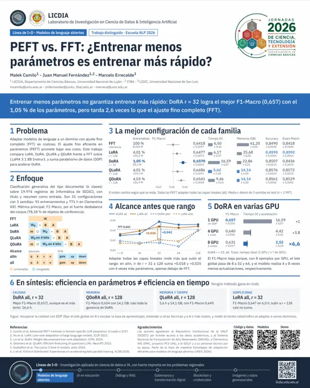
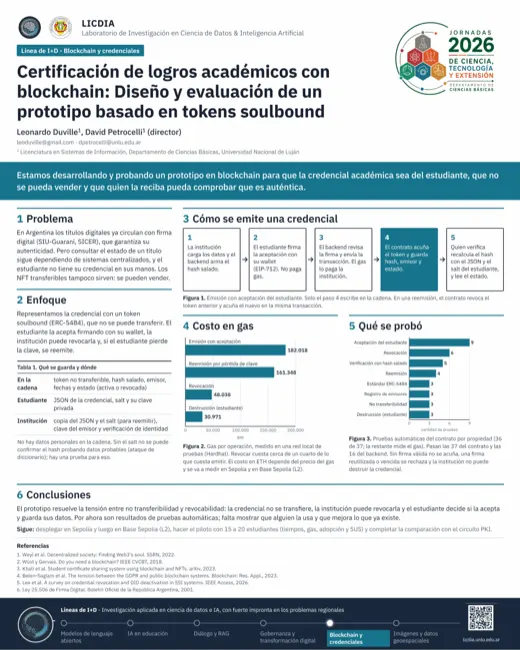
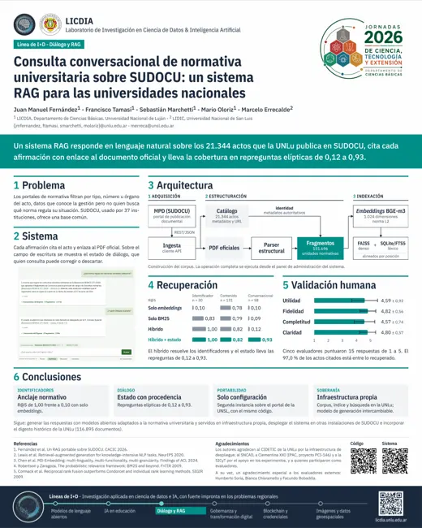
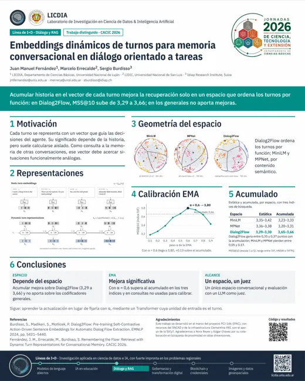
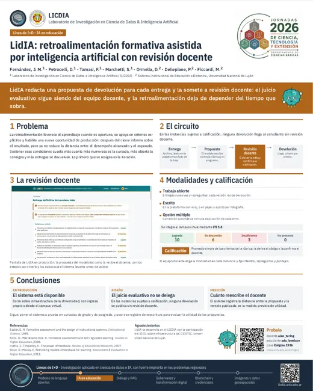
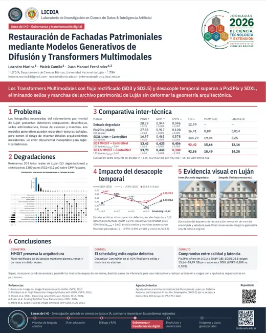
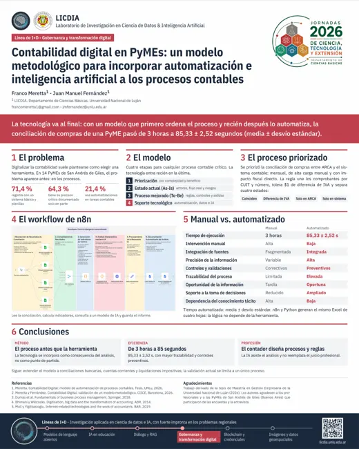
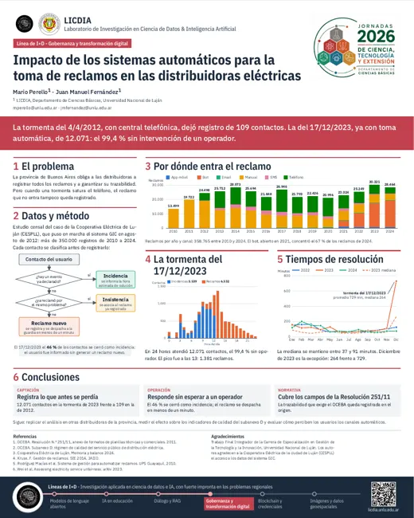
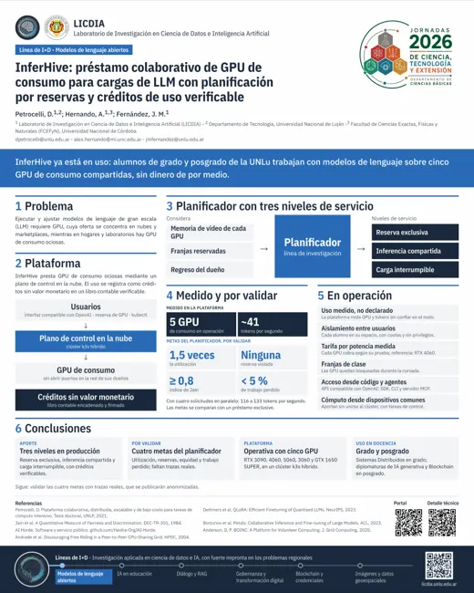
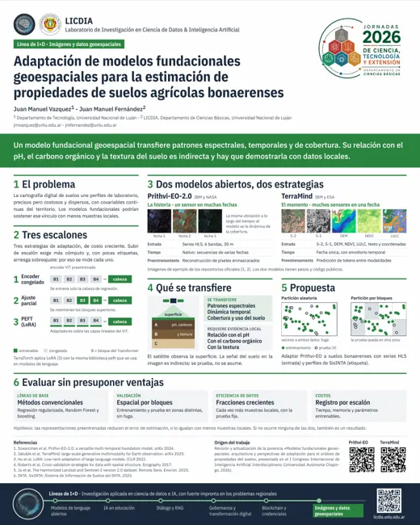

El LICDIA presentó diez pósters en las Jornadas de Ciencia, Tecnología y Extensión 2026 del Departamento de Ciencias Básicas de la UNLu. Los trabajos recorren las seis líneas de I+D del laboratorio e incluyen tesis y trabajos finales de grado y de posgrado.

Los pósters aparecen en un orden distinto en cada visita. Cada uno se abre con su síntesis y su resumen, y se puede ampliar para leerlo o descargar en PDF.

<section class="px" aria-label="Los diez pósters"><link rel="stylesheet" href="/css/blog-posters.css?v=2026-11-19">

jornadas-2026 · <b>10</b> pósters · <b>6</b> líneas de I+D

<ol class="px-muro"><li class="px-item" id="p-peft-vs-fft" data-linea="lenguaje" data-zoom="/assets/img/noticias/jornadas-2026/peft-vs-fft-2400.webp" data-sha="c05dd6a7034affcec5c46360c696b363d2c600ff412420db670a9d667a7bf0c3"><a class="px-tile" href="/assets/posters/jornadas-2026/peft-vs-fft.pdf">

Modelos de lenguaje abiertos
<h3 class="px-titulo">PEFT vs. FFT: ¿entrenar menos parámetros es entrenar más rápido?</h3>
Camilo, M.; Fernández, J. M.; Errecalde, M.
</a>

Entrenar menos parámetros no garantiza entrenar más rápido: DoRA r = 32 logra el mejor F1-Macro (0,657) con el 1,05 % de los parámetros, pero tarda 2,6 veces lo que el ajuste fino completo (FFT).

El costo de adaptar Grandes Modelos de Lenguaje (LLM) a dominios específicos impulsó estrategias de ajuste fino eficiente en parámetros (PEFT) como alternativa al ajuste fino completo (FFT). Este trabajo, basado en un artículo enviado a JCS&amp;T, evalúa LoRA, DoRA, QLoRA y QDoRA frente al FFT sobre 19.974 registros del dominio de Cs. de la Computación del repositorio institucional SEDICI, con LLaMA 3.1 8B Instruct como base. La tarea es la clasificación del tipo de recurso documental, formulada como generación condicional de texto, variando el rango de los adaptadores y las capas intervenidas. Los experimentos se ejecutaron en la supercomputadora Clementina XXI. Los resultados demuestran que DoRA con rango 32 alcanza el F1-Macro más alto (0,657), superando al FFT (0,642) con solo el 1,05 % de parámetros entrenables. Asimismo, la cuantización a 4 bits reduce la memoria máxima utilizada a 14,1 GB. No obstante, se observa una desconexión entre la fracción de parámetros entrenables y la velocidad: DoRA requiere 16,6 h, más del doble que el FFT. Para mitigarlo, se incorpora como novedad en este trabajo, el paralelismo de datos distribuido (DDP), que replica el modelo en varias GPU y promedia sus gradientes. Con 4 GPU en un nodo y 8 en dos nodos, el entrenamiento resulta hasta 7 veces más rápido; sin embargo, el incremento del lote global reduce el F1-Macro, lo que motiva la búsqueda de estrategias para preservarlo. En conjunto, se confirma que entrenar menos parámetros no garantiza entrenar más rápido.

<a class="px-pdf" href="/assets/posters/jornadas-2026/peft-vs-fft.pdf" download>PDF · 1,8 MB</a><code class="px-sha" title="SHA-256 del PDF: c05dd6a7034affcec5c46360c696b363d2c600ff412420db670a9d667a7bf0c3">sha256:c05dd6a7034a…</code>

</li><li class="px-item" id="p-credenciales-soulbound" data-linea="blockchain" data-zoom="/assets/img/noticias/jornadas-2026/credenciales-soulbound-2400.webp" data-sha="c14f4e390f9d7663066439a28e9e3166df9b89f2e600479d3a4cca1c0b3be8c2"><a class="px-tile" href="/assets/posters/jornadas-2026/credenciales-soulbound.pdf">

Blockchain y credenciales
<h3 class="px-titulo">Certificación de logros académicos con blockchain: diseño y evaluación de un prototipo basado en tokens soulbound</h3>
Duville, L.; Petrocelli, D.
</a>

Estamos desarrollando y probando un prototipo en blockchain para que la credencial académica sea del estudiante, que no se pueda vender y que quien la reciba pueda comprobar que es auténtica.

La certificación de logros académicos en Argentina se apoya en un circuito de firma digital (SIU-Guaraní, SICER) que depende de la continuidad institucional del emisor y no da al estudiante control portable sobre sus credenciales. Según el árbol de decisión de Wüst y Gervais, blockchain se justifica aquí solo por dos argumentos: verificabilidad independiente de la disponibilidad del emisor y supervivencia de la credencial ante el cierre institucional. Esta tesina de grado en curso diseña y evalúa un prototipo de credenciales no transferibles y revocables mediante tokens soulbound (ERC-5484), con aceptación explícita del estudiante, revocación institucional, registro on-chain de emisores autorizados y reemisión ante la pérdida de clave privada, desplegado sobre la testnet Sepolia, sin datos personales en la cadena; el marco legal (leyes 25.326 y 25.506) requiere además acoplarlo a firma digital certificada para acreditar autoría. La evaluación tiene dos niveles: esos dos argumentos se contrastan analíticamente con el modelo de amenazas del circuito PKI vigente. La viabilidad técnica se mide en una prueba piloto con estudiantes ingresantes y avanzados que recorren el flujo de emisión, aceptación y validación externa, registrando tiempo de emisión, tiempo de validación, costo de gas por credencial proyectado a Ethereum y redes L2, y porcentaje de adopción del flujo completo. El baseline sin blockchain surge de tiempos documentados y de entrevistas con personal de Secretaría Académica, y una encuesta post-piloto releva barreras de adopción. El resultado se considera válido aunque la mejora frente a PKI resulte acotada o nula.

<a class="px-pdf" href="/assets/posters/jornadas-2026/credenciales-soulbound.pdf" download>PDF · 1,6 MB</a><code class="px-sha" title="SHA-256 del PDF: c14f4e390f9d7663066439a28e9e3166df9b89f2e600479d3a4cca1c0b3be8c2">sha256:c14f4e390f9d…</code>

</li><li class="px-item" id="p-rag-sudocu" data-linea="dialogo" data-zoom="/assets/img/noticias/jornadas-2026/rag-sudocu-2400.webp" data-sha="2434885f5ab41cbe8f78180fa364f5341b0b0d9741f38f0f1d9c15a3276df1e7"><a class="px-tile" href="/assets/posters/jornadas-2026/rag-sudocu.pdf">

Diálogo y RAG
<h3 class="px-titulo">Consulta conversacional de normativa universitaria sobre SUDOCU: un sistema RAG para las universidades nacionales</h3>
Fernández, J. M.; Tamasi, F.; Marchetti, S.; Oloriz, M. G.; Errecalde, M.
</a>

Un sistema RAG responde en lenguaje natural sobre los 21.344 actos que la UNLu publica en SUDOCU, cita cada afirmación con enlace al documento oficial y lleva la cobertura en repreguntas elípticas de 0,12 a 0,93.

Los portales de normativa universitaria suelen ofrecer búsqueda por atributos del acto, como el tipo, número u órgano emisor, que resultan familiares para el personal administrativo pero no para quien, ajeno a la gestión universitaria, busca información sobre una situación concreta. El Sistema Único Documental (SUDOCU), creado por la UNGS, adoptado por el SIU y utilizado por 37 instituciones, ofrece una base común: un módulo de publicación con interfaz de acceso uniforme. En este trabajo, que revisa y actualiza un artículo presentado en CACIC 2026, se presenta un sistema de consulta conversacional de normativa desarrollado en el LICDIA, que emplea generación aumentada por recuperación (RAG), responde en lenguaje natural y respalda cada afirmación con el fragmento citado y el enlace al documento oficial. El sistema opera sobre todos los actos publicados por la UNLu (21.344 documentos), segmentados por unidad normativa; combina recuperación semántica y léxica para preservar los identificadores normativos y mantiene un estado de diálogo visible y editable que resuelve repreguntas elípticas. En la evaluación, las consultas por identificador se resuelven íntegramente, la cobertura en repreguntas elípticas asciende de 0,12 a 0,93 y el 97 % de los actos citados tiene correspondencia con lo recuperado. La validación humana complementa estas métricas: cinco evaluadores calificaron utilidad, fidelidad, completitud y claridad por encima de 4,5 sobre 5. Diseñado para ser portable, el sistema está implementado en la UNLu, se replicó en la UNSL solo mediante configuración, y puede desplegarse en cualquier institución con un portal SUDOCU.

<a class="px-pdf" href="/assets/posters/jornadas-2026/rag-sudocu.pdf" download>PDF · 1,7 MB</a><code class="px-sha" title="SHA-256 del PDF: 2434885f5ab41cbe8f78180fa364f5341b0b0d9741f38f0f1d9c15a3276df1e7">sha256:2434885f5ab4…</code>

</li><li class="px-item" id="p-embeddings-turnos" data-linea="dialogo" data-zoom="/assets/img/noticias/jornadas-2026/embeddings-turnos-2400.webp" data-sha="97c713fa9854c287fb66dff71f62276e419211fad8ff9022a1d7de8df5c11d6b"><a class="px-tile" href="/assets/posters/jornadas-2026/embeddings-turnos.pdf">

Diálogo y RAG
<h3 class="px-titulo"><i>Embeddings</i> dinámicos de turnos para memoria conversacional en diálogo orientado a tareas</h3>
Fernández, J. M.; Errecalde, M.; Burdisso, S.
</a>

Acumular historia en el vector de cada turno mejora la recuperación solo en un espacio que ordena los turnos por función: en Dialog2Flow, MSS@10 sube de 3,29 a 3,66; en los generales no aporta mejoras.

En el diálogo orientado a tareas, cada turno se representa predominantemente mediante un vector denso (<i>embedding</i>) que orienta las decisiones del agente. Su significado depende de la historia acumulada, pero el vector suele calcularse de forma aislada. Estas representaciones pueden servir también como consultas a una memoria de situaciones de otras conversaciones, cuya utilidad exige que situaciones funcionalmente análogas queden próximas. En este trabajo, que revisa y actualiza un artículo presentado en CACIC 2026, se estudia cuánta historia debe incorporar la representación de un turno. Se comparan <i>embeddings</i> estáticos, un estado acumulativo normalizado y una media móvil exponencial (EMA) calibrada, sobre dos codificadores de propósito general y uno específico de diálogo (Dialog2Flow), en una colección de un millón de turnos con búsqueda aproximada de vecinos. Un modelo de lenguaje juzga la utilidad de los vecinos recuperados, siempre de otras conversaciones (MSS@10, de 1 a 5). Sobre Dialog2Flow, el estado acumulativo eleva la puntuación de 3,29 a 3,66 y mejora entre el 65 y el 68 % de las consultas; la EMA (α = 0,6) agrega una mejora menor pero significativa, también en consultas no usadas para calibrarla. Sobre los codificadores generales, la acumulación no aporta mejoras. El valor de recordar depende así de la geometría del espacio de base y no de la acumulación en sí: codificar la historia en la representación del turno es una vía eficaz hacia la memoria conversacional cuando ese espacio ya organiza los turnos según su función comunicativa.

<a class="px-pdf" href="/assets/posters/jornadas-2026/embeddings-turnos.pdf" download>PDF · 1,6 MB</a><code class="px-sha" title="SHA-256 del PDF: 97c713fa9854c287fb66dff71f62276e419211fad8ff9022a1d7de8df5c11d6b">sha256:97c713fa9854…</code>

</li><li class="px-item" id="p-lidia" data-linea="educacion" data-zoom="/assets/img/noticias/jornadas-2026/lidia-2400.webp" data-sha="592268e54c770bc32a3d7134a74d9ff775914f991a59466850aa610f6923f0f5"><a class="px-tile" href="/assets/posters/jornadas-2026/lidia.pdf">

IA en educación
<h3 class="px-titulo">LidIA: retroalimentación formativa asistida por inteligencia artificial con revisión docente</h3>
Fernández, J. M.; Petrocelli, D.; Tamasi, F.; Marchetti, S.; Ormella, D.; Dellepiane, P.; Ficcardi, M.
</a>

LidIA redacta una propuesta de devolución para cada entrega y la somete a revisión docente: el juicio evaluativo sigue siendo del equipo docente, y la retroalimentación deja de depender del tiempo que sobra.

La literatura sobre evaluación formativa sostiene que la retroalimentación favorece el aprendizaje cuando es oportuna, se apoya en criterios explícitos y habilita una nueva oportunidad de producción: una devolución posterior al cierre de la instancia informa sobre el resultado, pero no reduce la distancia entre el desempeño alcanzado y el esperado. El costo de sostener esas condiciones crece con la cantidad de estudiantes, con la apertura de la consigna, dado que un trabajo abierto exige argumentar criterio por criterio, y con el número de entregas que se devuelva a cada uno; lo primero que se resigna es la iteración, y la devolución se reduce a una calificación final. Se presenta LidIA, un sistema web desarrollado en el LICDIA con la participación del SIED de la UNLu, que redacta una propuesta de devolución para cada entrega. Admite trabajos abiertos con entregas sucesivas y repreguntas, exámenes escritos y cuestionarios de opción múltiple; los escritos pueden desarrollarse en la plataforma o rendirse en papel y subirse por fotografía. Se integra al campus virtual mediante LTI 1.3. El modelo no aporta criterios propios: evalúa según la rúbrica del equipo docente y el programa del curso, asignando a cada criterio uno de cuatro estados, de los que la calificación se deriva por código. En las instancias sujetas a calificación, ninguna devolución llega al estudiante sin revisión docente: el juicio evaluativo permanece en el equipo docente, que edita la propuesta antes de publicarla. El sistema registra cuánto la reescribe, magnitud prevista como medida de utilidad.

<a class="px-pdf" href="/assets/posters/jornadas-2026/lidia.pdf" download>PDF · 501 KB</a><code class="px-sha" title="SHA-256 del PDF: 592268e54c770bc32a3d7134a74d9ff775914f991a59466850aa610f6923f0f5">sha256:592268e54c77…</code>

</li><li class="px-item" id="p-restauracion-fachadas" data-linea="gobernanza" data-zoom="/assets/img/noticias/jornadas-2026/restauracion-fachadas-2400.webp" data-sha="05ece61612abe3e8af3bfc2fd368d9fb4f2a8b9949418ebbadacd26ff0a08d0d"><a class="px-tile" href="/assets/posters/jornadas-2026/restauracion-fachadas.pdf">

Gobernanza y transformación digital
<h3 class="px-titulo">Restauración de fachadas patrimoniales mediante modelos generativos de difusión y transformers multimodales</h3>
Marina, L.; Camilo, M.; Fernández, J. M.
</a>

Los Transformers Multimodales con flujo rectificado (SD3 y SD3.5) y desacople temporal superan a Pix2Pix y SDXL, eliminando sellos y manchas del archivo patrimonial de Luján sin deformar la geometría arquitectónica.

Las fotografías escaneadas que integran el sistema de relevamiento del patrimonio edilicio desarrollado por el LICDIA para el Municipio de Luján presentan deterioros acumulados: baja resolución, pixelado, desbalance de brillo y contraste, manchas, sombras, rayones y artefactos de digitalización. Los modelos fundacionales de imágenes, entrenados sobre cientos de millones de escenas, aportan un conocimiento previo del mundo visual capaz de suplir la información perdida. Sin embargo, este mismo conocimiento representa un riesgo: un modelo que puede completar una cornisa también puede inventarla, y en un registro patrimonial un detalle plausible pero falso constituye un error documental. Este trabajo, en el marco de una tesis de Licenciatura en Sistemas de Información, diseña un <i>pipeline</i> reproducible de restauración y compara tres enfoques: Pix2Pix, red generativa adversaria condicional (generador U-Net y discriminador PatchGAN) entrenada desde cero como línea base; SDXL, modelo de difusión latente con <i>backbone</i> U-Net; y SD3, que reemplaza la U-Net por un Transformer multimodal (MMDiT) entrenado con flujo rectificado. Como las fotografías reales carecen de una versión limpia de referencia, el ajuste y la evaluación cuantitativa se apoyan en pares <i>(degradada, original)</i> obtenidos mediante degradaciones controladas sobre imágenes arquitectónicas y urbanas (Places365, CMP Facade, Urban100). Los modelos se comparan por fidelidad a la referencia (PSNR, SSIM), calidad perceptual (LPIPS, FID) y costo computacional, y luego se aplican a un caso de estudio con fotografías reales de ese sistema. Se presentan el diseño experimental y el estado de avance.

<a class="px-pdf" href="/assets/posters/jornadas-2026/restauracion-fachadas.pdf" download>PDF · 828 KB</a><code class="px-sha" title="SHA-256 del PDF: 05ece61612abe3e8af3bfc2fd368d9fb4f2a8b9949418ebbadacd26ff0a08d0d">sha256:05ece61612ab…</code>

</li><li class="px-item" id="p-contabilidad-pymes" data-linea="gobernanza" data-zoom="/assets/img/noticias/jornadas-2026/contabilidad-pymes-2400.webp" data-sha="e9cf1da5742bd0b93cb250109bc7eeec8a38b1a5d68ab4870105e8c109418a11"><a class="px-tile" href="/assets/posters/jornadas-2026/contabilidad-pymes.pdf">

Gobernanza y transformación digital
<h3 class="px-titulo">Contabilidad digital en PyMEs: un modelo metodológico para incorporar automatización e inteligencia artificial a los procesos contables</h3>
Meretta, F.; Fernández, J. M.
</a>

La tecnología va al final: con un modelo que primero ordena el proceso y recién después lo automatiza, la conciliación de compras de una PyME pasó de 3 horas a 85,33 ± 2,52 segundos (media ± desvío estándar).

La digitalización contable en las PyMEs suele plantearse como un problema de adopción: qué herramienta implementar. Este trabajo invierte esa pregunta y sostiene que la tecnología debe incorporarse como consecuencia del análisis de los procesos, y no como punto de partida. A partir de encuestas y entrevistas en catorce PyMEs de San Andrés de Giles (Buenos Aires), se diagnosticó un escenario de procesos poco formalizados, información fragmentada y marcada dependencia del conocimiento tácito. Sobre esa base se diseñó un modelo de Contabilidad Digital organizado en cuatro etapas: priorización del proceso según su complejidad y beneficio, análisis de su estado actual (As-Is), diseño del proceso mejorado (To-Be) y soporte tecnológico mediante automatización, analítica de datos e inteligencia artificial. El modelo se validó sobre la conciliación de compras entre ARCA y el sistema contable, proceso priorizado por su recurrencia y carga manual, mediante un prototipo desarrollado en n8n (plataforma low-code), con una capa de IA generativa que interpreta los resultados. Su reimplementación en Python arrojó resultados idénticos, lo que indica que la lógica del modelo no depende de la herramienta. En la empresa analizada, el tiempo del proceso pasó de 3 a 4 horas a 1 a 2 minutos, con mayor trazabilidad y controles preventivos. Aunque la validación se limita a un único proceso, los resultados sugieren que la digitalización en PyMEs depende más de una intervención metodológica ordenada que de grandes inversiones, y redefinen el rol del contador hacia el diseño de procesos y reglas de control.

<a class="px-pdf" href="/assets/posters/jornadas-2026/contabilidad-pymes.pdf" download>PDF · 1,7 MB</a><code class="px-sha" title="SHA-256 del PDF: e9cf1da5742bd0b93cb250109bc7eeec8a38b1a5d68ab4870105e8c109418a11">sha256:e9cf1da5742b…</code>

</li><li class="px-item" id="p-reclamos-distribuidoras" data-linea="gobernanza" data-zoom="/assets/img/noticias/jornadas-2026/reclamos-distribuidoras-2400.webp" data-sha="39f9f7bc11f99e0d0ac85741b0114deaf14136d7ee1b76af16a3a802f8607251"><a class="px-tile" href="/assets/posters/jornadas-2026/reclamos-distribuidoras.pdf">

Gobernanza y transformación digital
<h3 class="px-titulo">Impacto de los sistemas automáticos para la toma de reclamos en las distribuidoras eléctricas</h3>
Perelló, M.; Fernández, J. M.
</a>

La tormenta del 4/4/2012, con central telefónica, dejó registro de 109 contactos. La del 17/12/2023, ya con toma automática, de 12.071: el 99,4 % sin intervención de un operador.

Las distribuidoras eléctricas de la provincia de Buenos Aires, reguladas por el Organismo de Control de Energía Eléctrica (OCEBA), deben registrar los reclamos de los usuarios y garantizar su trazabilidad. Sin embargo, en picos de demanda, como tormentas, olas de calor o frío extremo, la atención telefónica se satura y parte de esos reclamos nunca llegan a registrarse.

En el marco de un Trabajo Final Integrador de la Especialización en Gestión de la Tecnología y la Innovación, se analiza el impacto de un sistema automático de toma y gestión de reclamos sobre esa capacidad de registro en la Cooperativa Eléctrica de Luján (CESPLL), que puso en marcha el sistema GIC en agosto de 2012. Con un enfoque cuantitativo censal, se analizaron más de 350.000 registros de reclamos del período 2010-2024, extraídos mediante consultas SQL y procesados con técnicas descriptivas y comparativas sobre su tipo, canal y tiempos de ingreso, despacho y resolución.

Los resultados muestran que la apertura progresiva de canales automáticos (IVR, SMS, aplicación móvil y chatbot) desplazó el registro hacia los canales desatendidos: en 2024 el chatbot concentró el 67 % de los reclamos. Entre dos eventos climáticos extremos, la tormenta del 4 de abril de 2012, con call center, y la del 17 de diciembre de 2023, con el sistema automático, los contactos atendidos pasaron de 109 a 12.071. El análisis de trazabilidad verifica, además, que el despacho a la guardia se produce automáticamente en menos de un minuto desde el ingreso del reclamo.

<a class="px-pdf" href="/assets/posters/jornadas-2026/reclamos-distribuidoras.pdf" download>PDF · 411 KB</a><code class="px-sha" title="SHA-256 del PDF: 39f9f7bc11f99e0d0ac85741b0114deaf14136d7ee1b76af16a3a802f8607251">sha256:39f9f7bc11f9…</code>

</li><li class="px-item" id="p-inferhive" data-linea="lenguaje" data-zoom="/assets/img/noticias/jornadas-2026/inferhive-2400.webp" data-sha="1d66f0db423aa3da10139bcce74f9c4af1f69adf7a55460fd368587cca0420b7"><a class="px-tile" href="/assets/posters/jornadas-2026/inferhive.pdf">

Modelos de lenguaje abiertos
<h3 class="px-titulo">InferHive: préstamo colaborativo de GPU de consumo para cargas de LLM con planificación por reservas y créditos de uso verificable</h3>
Petrocelli, D.; Hernando, A.; Fernández, J. M.
</a>

InferHive ya está en uso: alumnos de grado y posgrado de la UNLu trabajan con modelos de lenguaje sobre cinco GPU de consumo compartidas, sin dinero de por medio.

Ejecutar y ajustar modelos de lenguaje de gran escala requiere GPU, cuya oferta se concentra en nubes y <i>marketplaces</i>, mientras en hogares y laboratorios hay GPU de consumo ociosas. InferHive las presta mediante un plano de control en la nube, sin abrir puertos en la red de sus dueños, y registra el uso como créditos sin valor monetario en un libro contable encadenado y firmado. Un planificador ofrece tres niveles de servicio: reserva exclusiva, inferencia compartida y carga interrumpible, con franjas reservadas para las clases. La plataforma opera con cinco GPU (RTX 3090, 4060, 5060, 3060 y GTX 1650 SUPER) en un clúster k3s híbrido, con interfaz compatible con OpenAI, aislamiento entre usuarios y cuotas, y se usa en Sistemas Distribuidos en grado y en las diplomaturas de IA generativa y Blockchain en posgrado. Las cuatro metas del planificador (utilización, reservas, equidad y trabajo perdido) quedan por validar con trazas reales, que se publicarán anonimizadas.

<a class="px-pdf" href="/assets/posters/jornadas-2026/inferhive.pdf" download>PDF · 1,6 MB</a><code class="px-sha" title="SHA-256 del PDF: 1d66f0db423aa3da10139bcce74f9c4af1f69adf7a55460fd368587cca0420b7">sha256:1d66f0db423a…</code>

</li><li class="px-item" id="p-suelos-geoespaciales" data-linea="imagenes" data-zoom="/assets/img/noticias/jornadas-2026/suelos-geoespaciales-2400.webp" data-sha="b70e7ca2bd817a7ea741b8a5d67c80c21863b690d382272c2c31a2f24d465be1"><a class="px-tile" href="/assets/posters/jornadas-2026/suelos-geoespaciales.pdf">

Imágenes y datos geoespaciales
<h3 class="px-titulo">Adaptación de modelos fundacionales geoespaciales para la estimación de propiedades de suelos agrícolas bonaerenses</h3>
Vazquez, J. M.; Fernández, J. M.
</a>

Un modelo fundacional geoespacial transfiere patrones espectrales, temporales y de cobertura. Su relación con el pH, el carbono orgánico y la textura del suelo es indirecta y hay que demostrarla con datos locales.

La cartografía digital de suelos vincula perfiles de campo y análisis de laboratorio, precisos pero costosos y dispersos, con covariables que cubren el territorio de forma continua (topografía, clima, sensores remotos). Los modelos fundacionales para observación de la Tierra, preentrenados sin etiquetas sobre grandes volúmenes de imágenes satelitales, ofrecen representaciones que podrían fortalecer ese vínculo o sostenerlo con menos muestras locales. En este trabajo, en el cual se realiza una revisión y actualización de una ponencia presentada en el I Congreso Internacional de Inteligencia Artificial Interdisciplinario (Universidad Autónoma Chapingo, 2026), se analizan dos modelos abiertos con estrategias contrastantes: Prithvi-EO-2.0, que incorpora la dimensión temporal mediante series HLS a 30 m, y TerraMind, que integra múltiples modalidades sobre una fecha única. Se examinan su preentrenamiento, sus requisitos de entrada y tres estrategias de adaptación de costo creciente: encoder congelado, ajuste parcial y ajuste eficiente de parámetros. El análisis delimita qué puede transferirse del preentrenamiento (patrones espectrales, temporales y de cobertura) y qué requiere evidencia local: la relación con el pH, el carbono orgánico y la textura, cuya señal en la imagen es indirecta. Sobre esa base se propone adaptar Prithvi-EO a suelos agrícolas de la provincia de Buenos Aires, integrando series HLS con perfiles georreferenciados de SisINTA, y evaluarlo frente a métodos convencionales mediante validación espacial por bloques, fracciones crecientes de muestras y registro de costos de adaptación. La hipótesis es que las representaciones preentrenadas reducen el error de estimación, o lo igualan con menos muestras locales.

<a class="px-pdf" href="/assets/posters/jornadas-2026/suelos-geoespaciales.pdf" download>PDF · 1,8 MB</a><code class="px-sha" title="SHA-256 del PDF: b70e7ca2bd817a7ea741b8a5d67c80c21863b690d382272c2c31a2f24d465be1">sha256:b70e7ca2bd81…</code>

</li></ol></section>

Además, Mario Oloriz y Juan Manuel Fernández presentaron en exposición oral el trabajo «Gobernanza de la inteligencia artificial en las instituciones de educación superior: componentes regulatorios, éticos y organizacionales».
